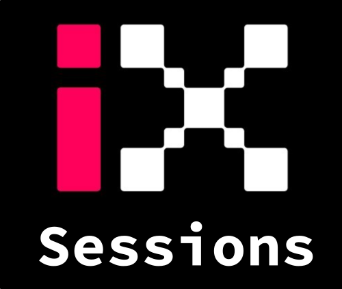

<h1>I-X AI in Science Resources</h1>

<!--

  Learning materials, technical sessions and computing guidance for the
  I-X AI in Science community.

-->

  <a class="homepage-card" href="learning-resources/">
    
    

      <h2>Learning Resources</h2>
      

        Curated books, courses, tutorials and resources for machine learning,
        statistics, scientific computing and AI in science.
      

      Explore resources →
    

  </a>

  <a class="homepage-card" href="sessions/">
    
    

      <h2>Sessions</h2>
      

        Programming clubs, technical tutorials, book-club materials and talks
        delivered by the I-X community.
      

      Browse sessions →
    

  </a>
  
  <a class="homepage-card" href="professional-development/">
    
    

      <h2>Professional Development</h2>
      

          Past & Upcoming Professional Development Workshops
      

      Browse workshops →
    

  </a>

  <a class="homepage-card" href="hpc/">
    
    

      <h2>HPC Resources</h2>
      

        Practical guidance for using I-X computing infrastructure, GPUs,
        environments and scheduled workloads.
      

      View HPC guides →
    

  </a>
  

<h2>About this repository</h2>

  This site brings together resources developed for the I-X AI in Science
  Fellowship, alongside selected external material for scientists and
  engineers using AI in their research.

  The repository includes practical notebooks, slides, recorded sessions,
  event materials and curated learning pathways. Content is updated as new
  sessions and resources become available.

<h2>Getting started</h2>

<ul>
  <li>
    New to AI and machine learning?
    Start with the <a href="learning-resources/">learning resources</a>.
  </li>
  <li>
    Looking for practical notebooks?
    Browse the <a href="sessions/programming-club/">Programming Club</a>.
  </li>
  <li>
    Setting up a GPU job?
    Visit the <a href="hpc/">HPC resources</a>.
  </li>
</ul>

<h2>Contributing</h2>

  Contributions from I-X fellows are welcome. Resources are maintained in the
  associated GitHub repository and published automatically to this website.

