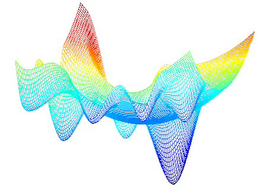
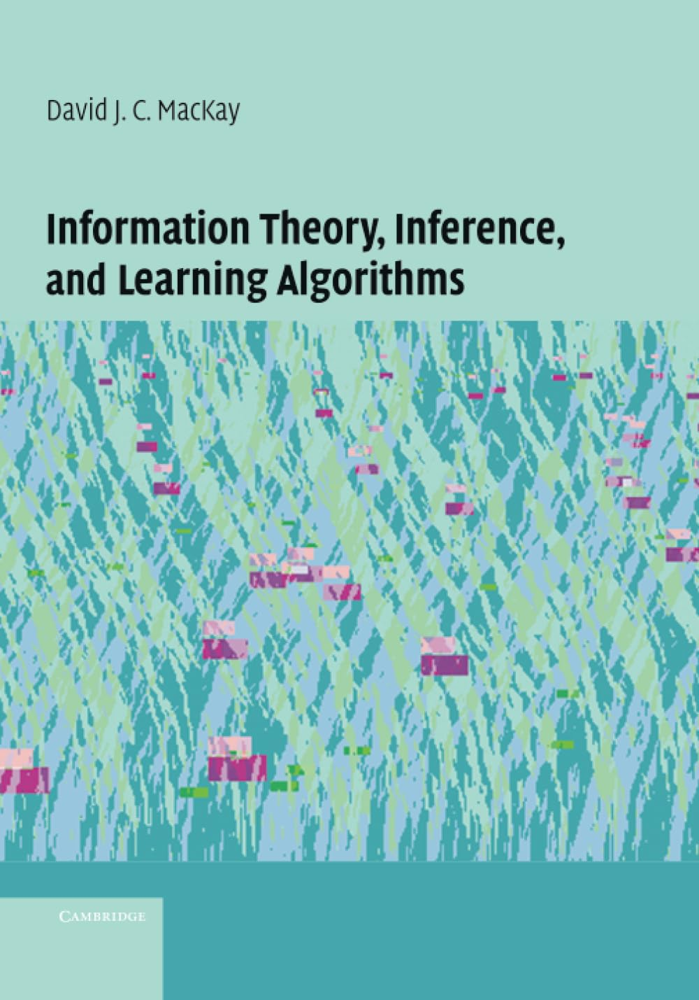

# Book Club

  <a class="resource-card" href="deep-generative-modelling/">
    
    

      <h2>Deep Generative Modelling</h2>
      
by Jakub M. Tomczak

    

  </a>

  <a class="resource-card" href="representation-learning/">
    
    

      <h2>Representation Learning: A Review and New Perspectives</h2>
      
by Yoshua Bengio, Aaron Courville, Pascal Vincent

    

  </a>
  
  <a class="resource-card" href="bayesopt/">
    
    

      <h2>A Tutorial on Bayesian Optimisation</h2>
      
by Peter I. Frazier

    

  </a>
  
  
  <a class="resource-card" href="mackay/">
    
    

      <h2>Information Theory, Inference and Learning Algorithms</h2>
      
by David MacKay - Short Course on Information Theory

    

  </a>
  

