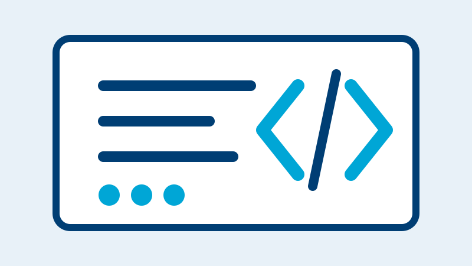
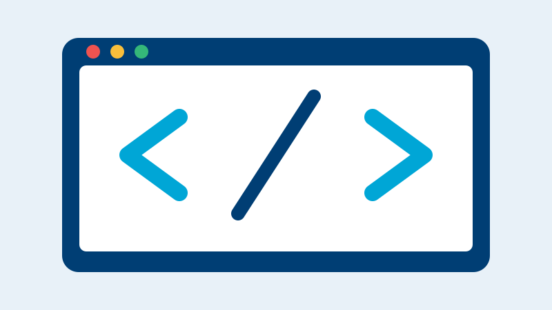
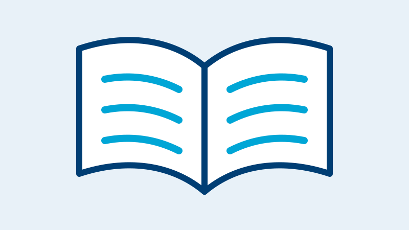

# I-X Sessions

Here at I-X, we run different sessions each week focused on developing AI in Science skills. These include talks, technical tutorials, programming clubs and book clubs.

  <a class="resource-card" href="talks/">
    
    

      <h2>Talks</h2>
      

        Short talks from fellows and visitors about their research, methods
        and applications of AI in science.
      

      Browse talks →
    

  </a>

  <a class="resource-card" href="technical-tutorials/">
    
    

      <h2>Technical Tutorials</h2>
      

        Detailed tutorials led by fellows, with notebooks, slides and
        supporting technical materials.
      

      Browse tutorials →
    

  </a>

  <a class="resource-card" href="programming-club/">
    
    

      <h2>Programming Club</h2>
      

        Practical coding sessions covering scientific Python, data analysis,
        optimisation and machine-learning methods.
      

      Browse sessions →
    

  </a>

  <a class="resource-card" href="book-club/">
    
    

      <h2>Book Club</h2>
      

        Group reading and discussion sessions on information theory,
        probability, Bayesian inference and machine learning.
      

      Browse materials →
    

  </a>

