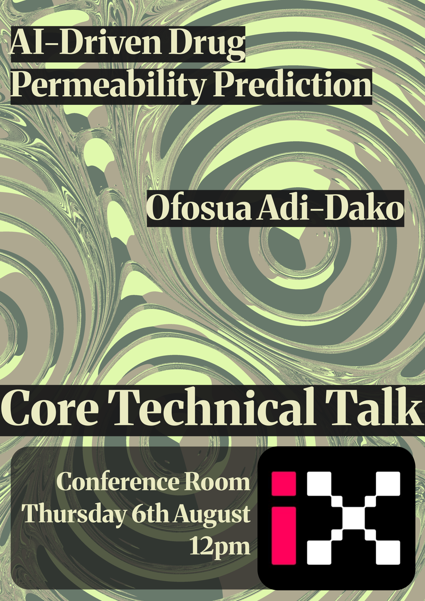

<!-- Generated by code/generate_sessions.py; edit source event.yml files. -->

# List of Talks

| Date | Title | Author | Resources |
|---|---|---|---|
| 2026-10-15 | Multifidelity Machine Learning Interatomic Potentials for Charged Defect Systems | Xinwei Wang | — |
| 2026-10-08 | Bayesian Regression with Autoregressive Noise for Mechanical Properties of Ceramics | Felipe Hawthorne Gomes da Costa | — |
| 2026-09-24 | Frontiers of Flexible Photovoltaics | Joseph Asare | — |
| 2026-09-03 | AI-Enhanced Data Imputation for Self-Generating Digital Twins | Shady Adib | — |
| 2026-08-27 | A Journey in Machine Learning for Molecular Property Prediction | Daniela Andrade Damasceno | — |
| 2026-08-25 | Medical AI: The Quest for Superintelligence | Bruce Bassett | — |
| 2026-08-06 | AI-Driven Drug Permeability Prediction | Ofosua Adi-Dako | — |
| 2026-07-23 | Why Does the Brain Make Abstractions? | Hardik Rajpal | — |
| 2026-07-16 | Using AI to Infer Circadian Clock Phase from Snapshot Datasets | Shaon Chakrabarti | — |
| 2026-07-09 | [Can Machine Learning Help in Reconstructing Hydrometeorological Time-Series from the Past?](2026-07-09-Bramha/slides.pdf) | Bramha Vishwakarma | [Slides](2026-07-09-Bramha/slides.pdf) |
| 2026-07-07 | Smartphone-based Road Trauma Triage: Inferring Crash Exposure from Low-fidelity Data | Claire Baker | — |
| 2026-06-25 | [Neural Network Adaptive-Order Methods for High-Fidelity Flow Simulation](2026-06-25-Ratnesh/slides.pdf) | Ratnesh Shukla | [Slides](2026-06-25-Ratnesh/slides.pdf) |
| 2026-06-18 | Artificial Intelligence and the Problem of Unexplainable Discovery | Sumeet Agarwal | — |
| 2026-06-18 | AI for Optimising the SNAILS Biosensor | Awo Afi Kwapong | — |
| 2026-06-11 | [Changing the Perspective: Model Discovery in Data-Driven Coordinates](2026-06-11-Farbod/slides.pdf) | Farbod Faraji | [Slides](2026-06-11-Farbod/slides.pdf) |
| 2026-06-04 | Title to be announced | Ivan Coelho Machado | — |
