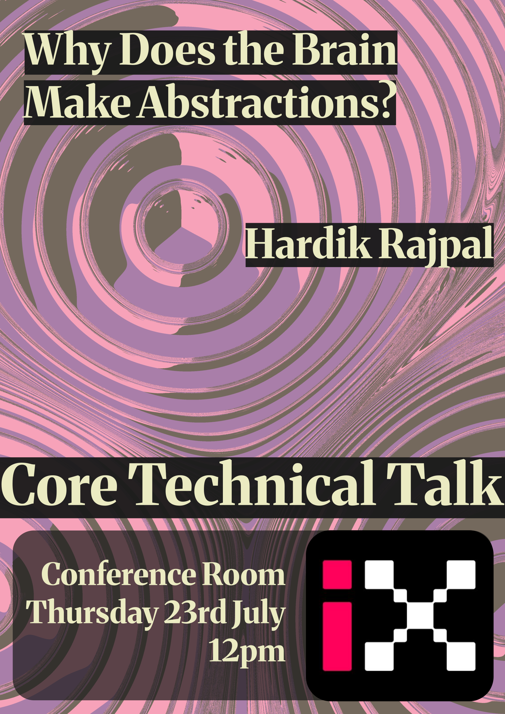
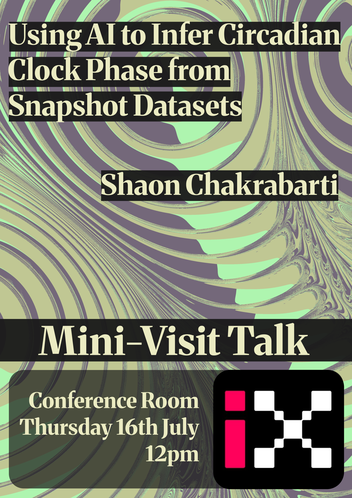
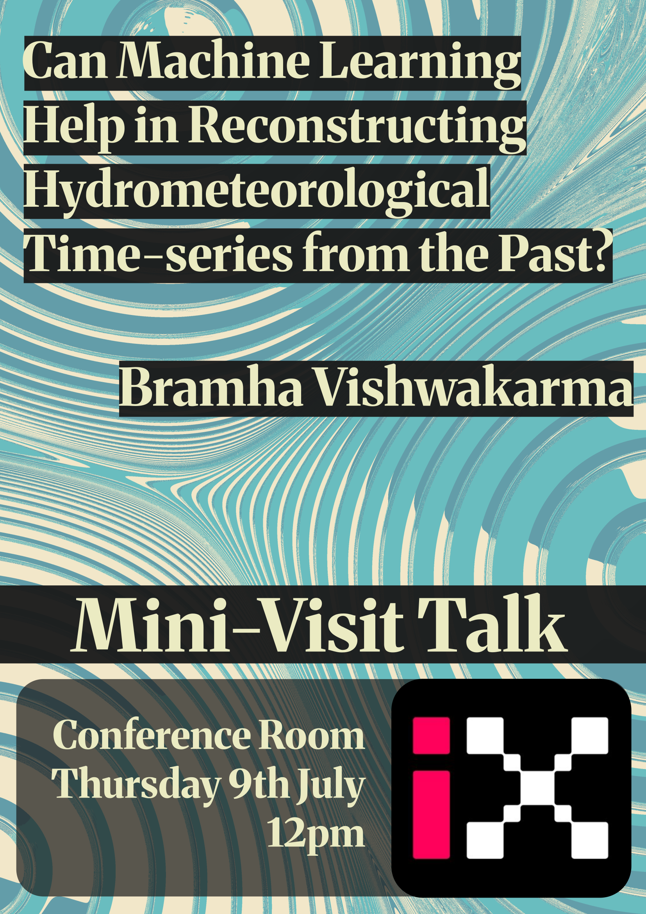
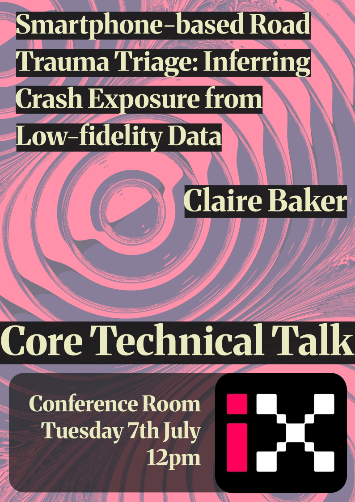
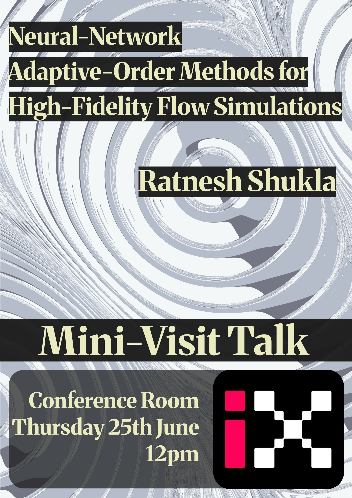
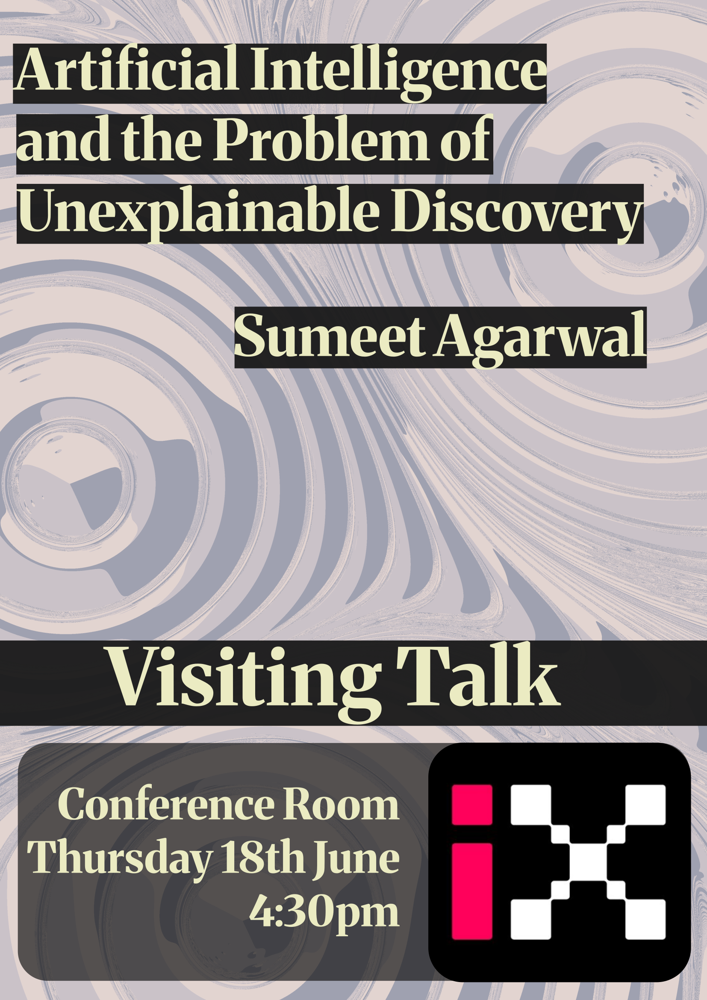
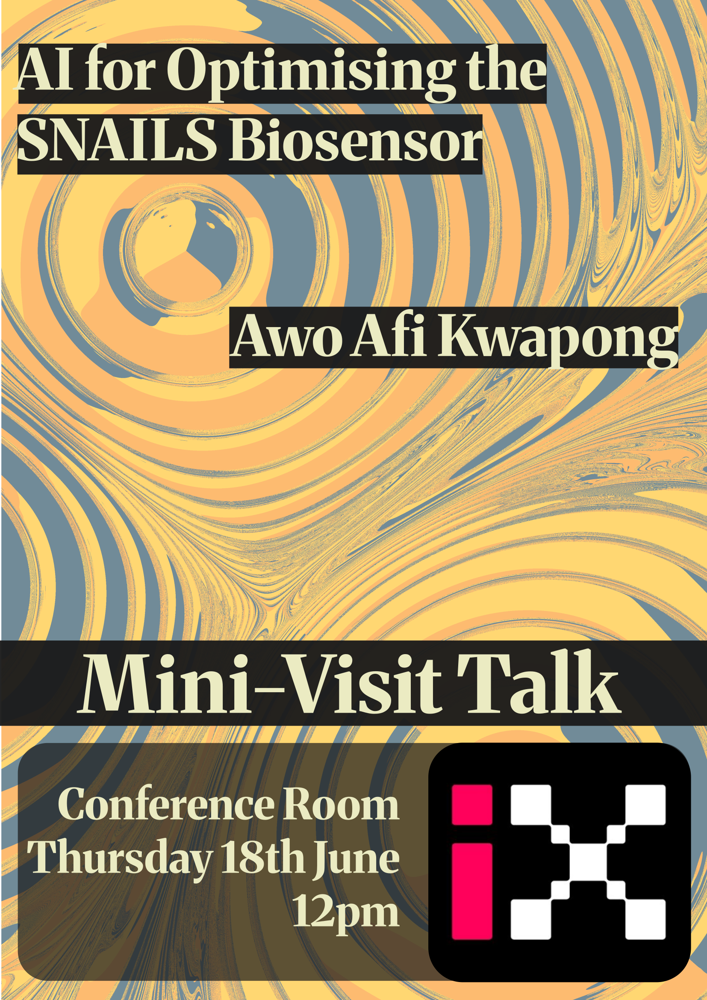
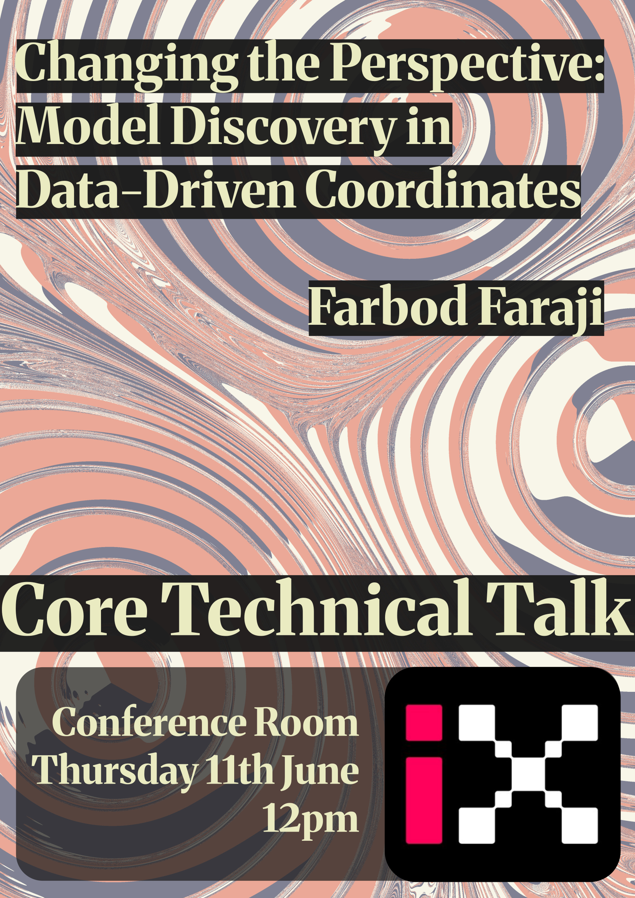

# Posters

    
    
    
    
    
    
    
    

 
# List of Talks

| Date | Talk | Speaker |
|---|---|---|
| 2026-07-23 | Why Does the Brain Make Abstractions? | Hardik Rajpal |
| 2026-07-16 | Using AI to Infer Circadian Clock Phase from Snapshot Datasets | Shaon Chakrabarti |
| 2026-07-09 | [Can Machine Learning Help in Reconstructing Hydrometeorological Time-Series from the Past?](../../assets/slides/2026-07-09-Bramha.pdf) | Bramha Vishwakarma |
| 2026-07-07 | Smartphone-based Road Trauma Triage: Inferring Crash Exposure from Low-fidelity Data | Claire Baker |
| 2026-06-25 | [Neural Network Adaptive-Order Methods for High-Fidelity Flow Simulation](../../assets/slides/2026-06-25-Ratnesh.pdf) | Ratnesh Shukla |
| 2026-06-18 | Artificial Intelligence and the Problem of Unexplainable Discovery | Sumeet Agarwal |
| 2026-06-18 | AI for Optimising the SNAILS Biosensor | Awo Afi Kwapong |
| 2026-06-11 | [Changing the Perspective: Model Discovery in Data-Driven Coordinates](../../assets/slides/2026-06-11-Farbod.pdf) | Farbod Faraji |
| 2026-06-04 | None | Ivan Coelho Machado |
